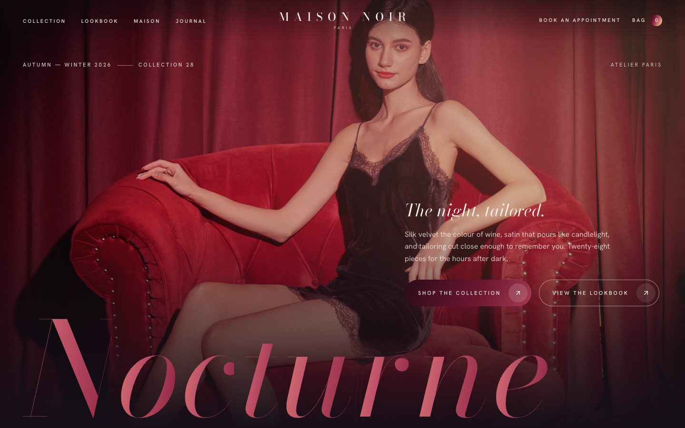
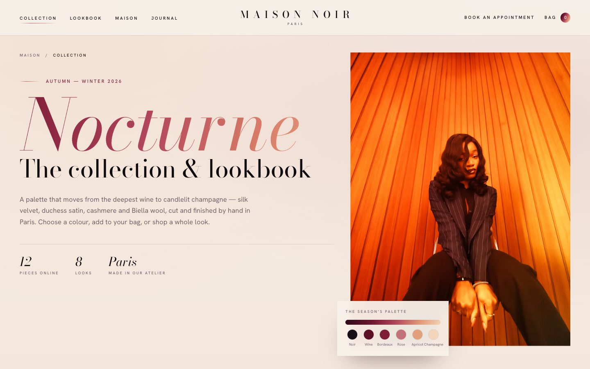
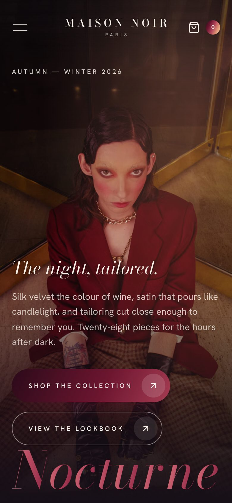
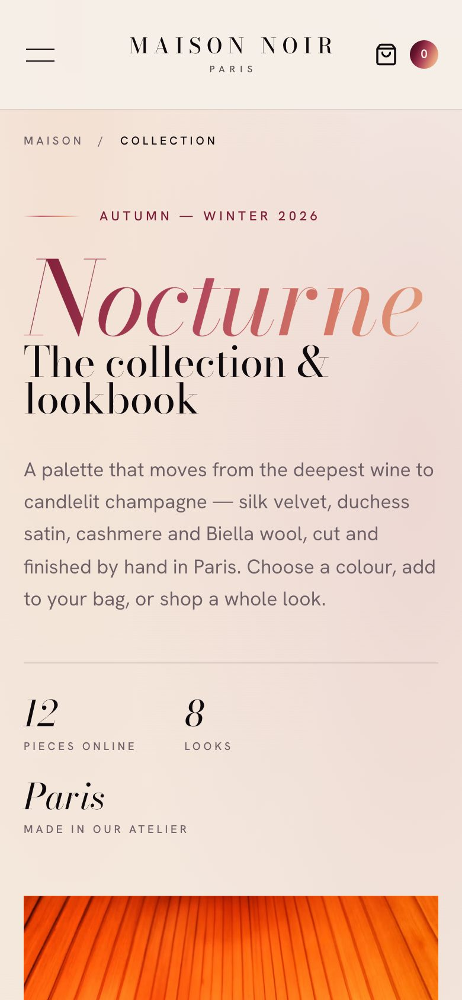

# Maison Noir

> *The night, tailored.*

A two-page website for **Maison Noir**, a fictional Paris fashion house, showing its Autumn–Winter 2026 collection, *Nocturne*. The art direction is couture editorial: high-contrast Bodoni display type, ink and ivory canvases, and a signature "bloom" gradient that runs from deep wine through bordeaux and rose to apricot and champagne. The gradient washes over photography, fills headlines and buttons, and drifts behind dark sections as a soft aurora.

**Live site:** _pending deployment_



## Features

- **Cinematic hero**
  - The campaign photograph opens from a centred clip and settles from a slow zoom.
  - A giant gradient *Nocturne* wordmark rises letter by letter with a moving sheen, then drifts sideways as you scroll.
  - Art-directed images: a landscape frame on desktop and a portrait frame on phones.
- **Gradient system**
  - A five-stop house gradient used for text, buttons, progress bars and filter pills.
  - Photo washes in `soft-light` that recede on hover.
  - Animated aurora backgrounds on the dark sections.
- **Home page**
  - A masked word-reveal manifesto with count-up figures and parallax imagery.
  - The new collection introduction.
  - **Featured looks**: a pinned editorial spread on desktop that travels sideways as you scroll down; a native swipe row on touch screens.
  - Atelier philosophy pillars and a scroll-driven campaign gallery.
  - Journal stories that open in an accessible dialog.
  - Private appointments and a newsletter sign-up with interest chips.
- **Collection page**
  - Hero with a palette card.
  - A shop grid of 12 pieces with category filters (an animated gradient pill) and price sorting.
  - Per-product colour swatches that tint the photograph toward the chosen shade.
  - An eight-look **lookbook** where "Shop the look" adds every piece in one click.
  - Footer links such as `/collection?category=Outerwear` open with that filter selected.
- **Shopping bag**
  - A slide-in drawer with quantities, subtotal and a free-delivery progress bar.
  - The bag persists in `localStorage` between visits.
- **Accessibility**
  - Skip link and landmarks.
  - Focus-trapped menu, bag and dialogs, all closing with Esc.
  - `aria-pressed` filters and swatches.
  - Screen-reader text for animated headings and counters.
  - Labelled form errors and visible focus states.
- **Reduced motion**: Framer Motion follows the OS setting, scroll-linked effects render statically, the pinned spread becomes a swipe row, and CSS animations stop.
- **SEO**: per-page titles, descriptions, Open Graph images and canonical URLs, plus a sitemap, robots file and favicon.

## Pages

| Route         | Contents |
| ------------- | -------- |
| `/`           | Hero, house statement, new collection, featured looks, philosophy, campaign, journal, appointments & newsletter |
| `/collection` | Collection hero, filterable shop grid with colour swatches, lookbook with "Shop the look", closing CTA |

## Design system

| Token     | Value     | Use |
| --------- | --------- | --- |
| Ink       | `#0E0A0D` | Type, darkest sections |
| Noir      | `#160F17` | Dark backgrounds |
| Wine      | `#5C1027` | Gradient start, accents |
| Bordeaux  | `#7D1D38` | Labels, focus rings |
| Rose      | `#C2707A` | Gradient midpoint |
| Apricot   | `#E3A07C` | Gradient warmth |
| Champagne | `#F1D6BC` | Gradient end, highlights |
| Ivory     | `#F7F1EA` | Page background |

**House gradient:** `linear-gradient(115deg, #2b0a19, #6e1630 28%, #b0445a 52%, #e39a78 78%, #f2d3b6)`

**Type:** Bodoni Moda (variable optical size, roman and italic) for display, and Hanken Grotesk for text and labels.

## Tech stack

Next.js 16 (App Router, static) · React 19 · TypeScript · Tailwind CSS v4 · Framer Motion · Lucide · Unsplash CDN via a custom `next/image` loader.

## Getting started

Requires Node.js 20.9+.

```bash
npm install
npm run dev      # http://localhost:3000
```

```bash
npm run build && npm start   # production build
npm run lint
```

## Deployment

```bash
npx vercel --prod
```

Set `NEXT_PUBLIC_SITE_URL` when using a custom domain.

## Project structure

```
app/                    routes, layout, page transitions, SEO files
components/home/        hero, statement, collection intro, featured looks, philosophy, campaign, journal, appointments
components/collection/  hero, shop grid, lookbook, CTA
components/bag/         bag context (persisted) and drawer
components/layout/      navbar, mobile menu, footer, legal dialog
components/motion/      Reveal, WordReveal, Counter, Parallax
components/ui/          GradientButton, Aurora, Title, Accordion, Img
lib/                    site config, product/look/journal data, hooks
```

## Screenshots

| Home | Collection |
| ---- | ---------- |
|  |  |
|  |  |

## Notes

- Maison Noir, its collection, products, prices, staff and address are fictional.
- The bag and checkout are a demo. **No payment is taken and no order is placed.** The newsletter validates client-side and stores nothing.
- Photography is from [Unsplash](https://unsplash.com) under the [Unsplash License](https://unsplash.com/license). Two photos were published by real brands (MANITO SILK and Vooglam Eyewear). For client or commercial use, swap them for neutral images.

## License

Code released under the [MIT License](LICENSE).
